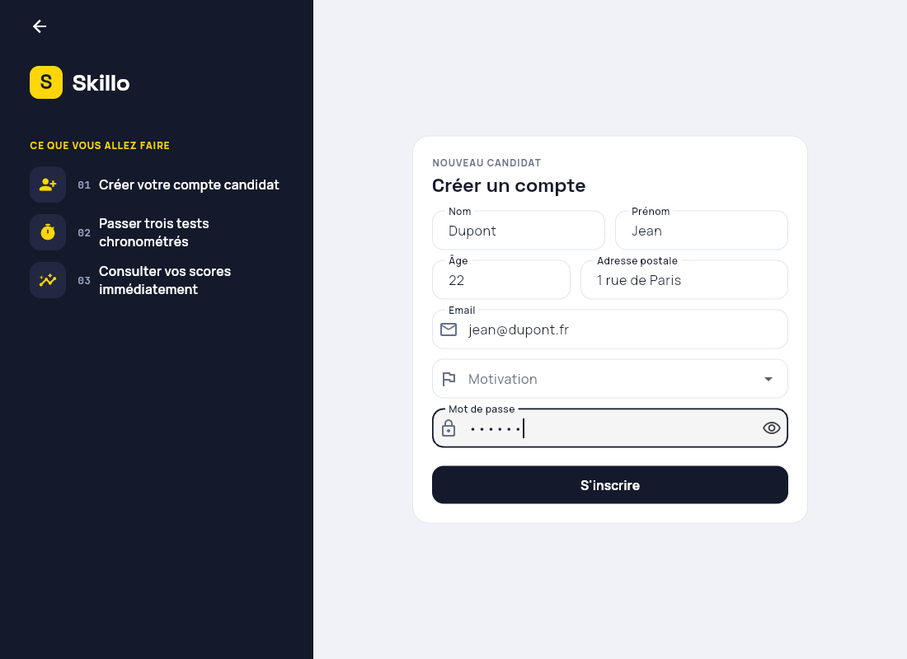
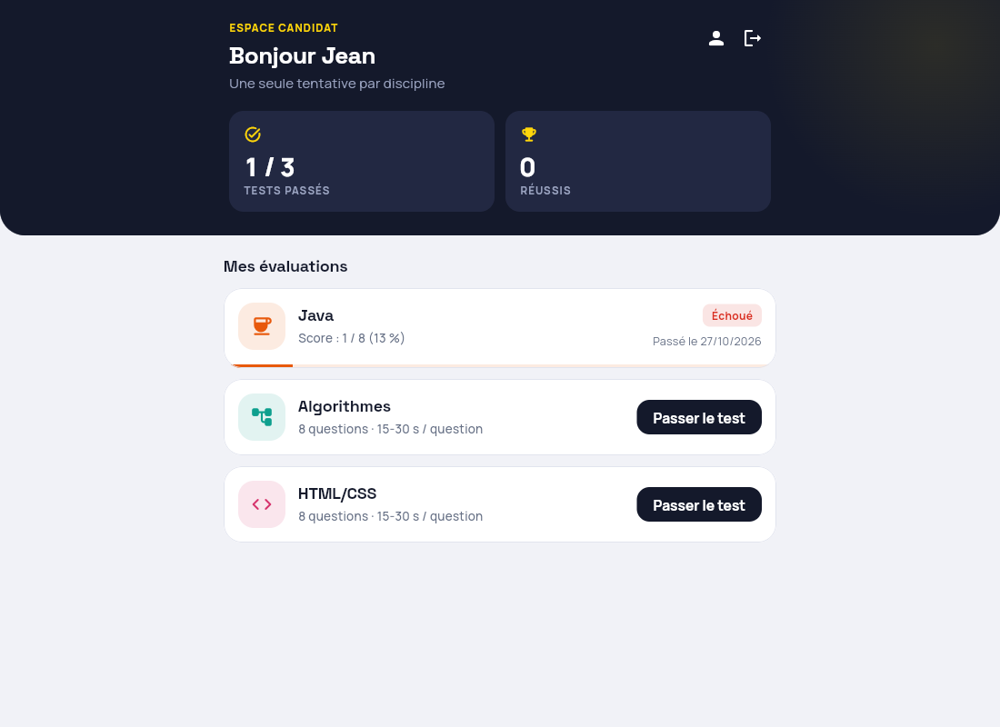
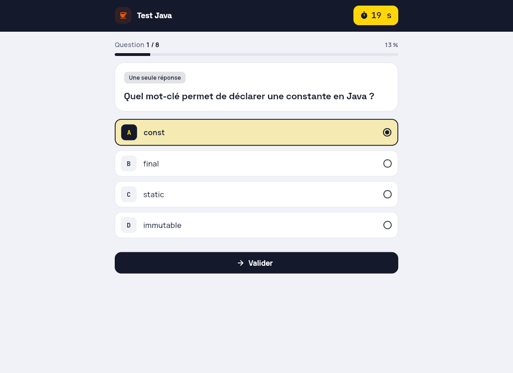
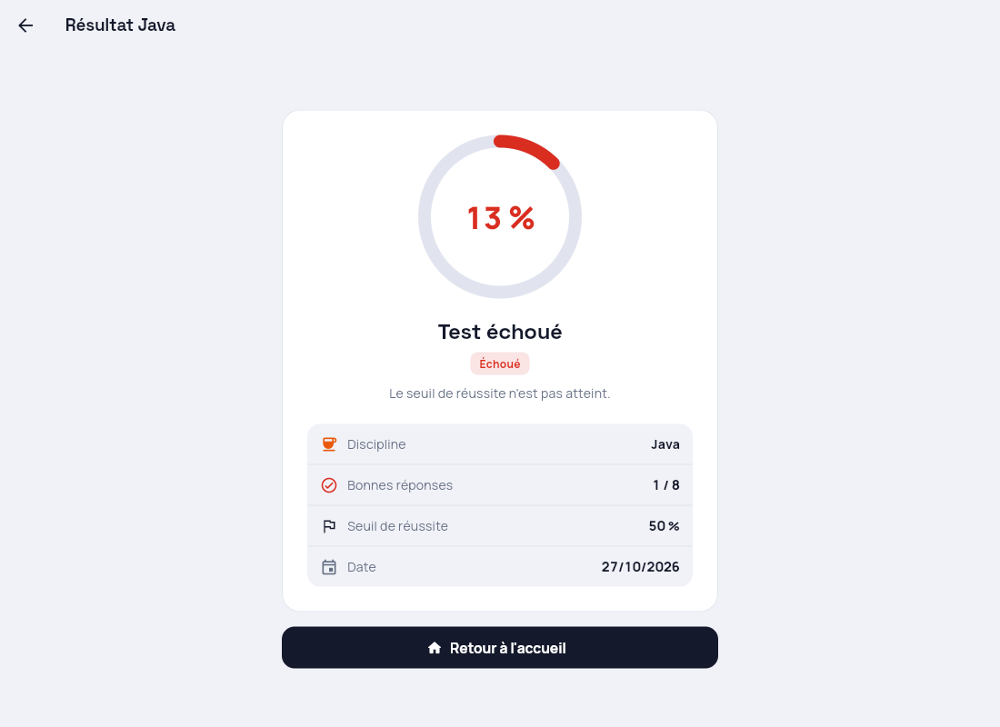
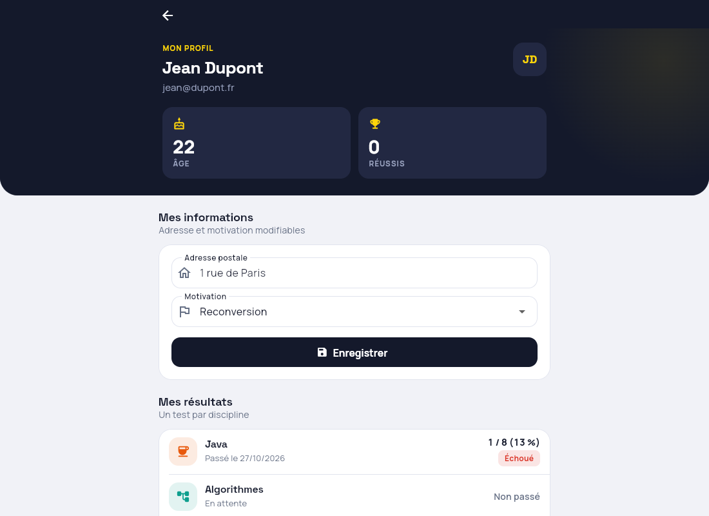
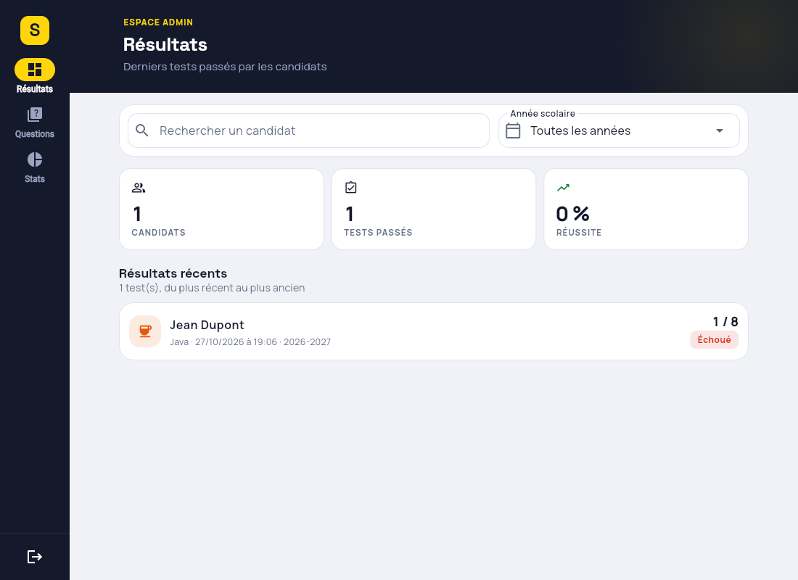
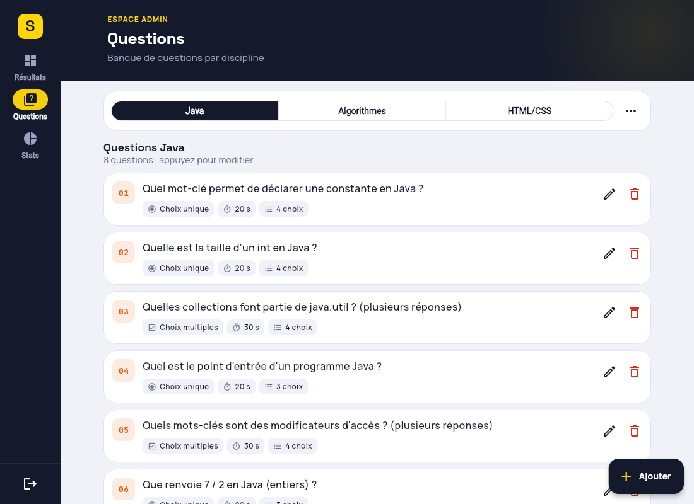
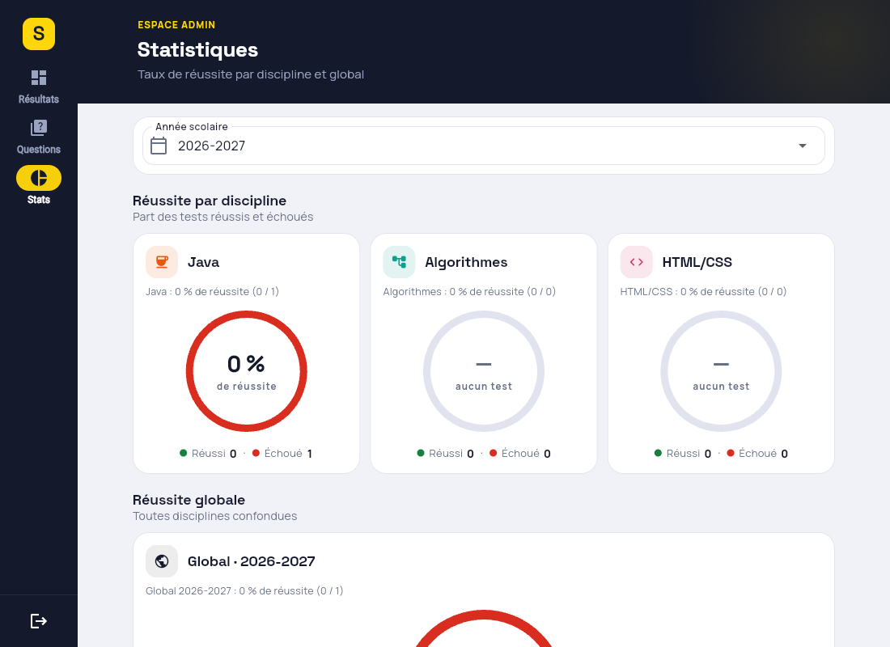

# Skillo — plateforme d'évaluation en ligne

Application Flutter réalisée dans le cadre du projet **Flutter4J** (groupe de 4, EduScrum).
Elle permet à des candidats de passer des tests (Java, Algorithmes, HTML/CSS) et à un
administrateur de gérer les questions, de suivre les résultats et de visualiser les taux de
réussite.

## Fonctionnalités (user stories du backlog)

| US | Fonctionnalité | Où dans le code |
|----|----------------|-----------------|
| 1 | Inscription candidat (nom, prénom, mail, âge, adresse, motivation), compte unique par nom + email | `screens/auth/register_screen.dart`, `data/user_repository.dart` |
| 2 | Passer un test par discipline, une seule fois, temps limite par question, résultat enregistré | `screens/candidate/test_screen.dart`, `logic/scoring.dart`, `data/result_repository.dart` |
| 3 | Profil : scores de chaque test, modification de l'adresse et de la motivation | `screens/candidate/profile_screen.dart` |
| 4 | Connexion administrateur avec un compte pré-existant en base | `data/app_database.dart` (seed), `screens/auth/login_screen.dart` |
| 5 | Ajout / édition / suppression de questions (radio ou checkbox, temps limite), import JSON pour réinitialiser une discipline | `screens/admin/questions_screen.dart`, `question_editor_screen.dart`, `json_import_screen.dart`, `logic/question_json.dart` |
| 6 | Tableau de bord : derniers résultats, recherche par nom/prénom, filtre par année scolaire | `screens/admin/dashboard_screen.dart` |
| 7 | Camemberts de réussite par discipline et camembert global par année | `screens/admin/stats_screen.dart` |

## Captures d'écran (build web)

| Connexion | Inscription | Accueil candidat |
|---|---|---|
|  |  |  |

| Test chronométré | Résultat | Profil |
|---|---|---|
|  |  |  |

| Admin · tableau de bord | Admin · questions | Admin · statistiques |
|---|---|---|
|  |  |  |

## Lancer l'application

Prérequis : [Flutter](https://docs.flutter.dev/get-started/install) 3.47 ou plus récent.

```bash
flutter pub get
flutter run -d chrome        # web
flutter run -d <device>      # Android (émulateur ou téléphone)
flutter build web --release  # bundle dans build/web/
flutter build apk --debug    # APK dans build/app/outputs/flutter-apk/
```

Sur le web, SQLite tourne en WebAssembly : les fichiers `web/sqflite_sw.js` et
`web/sqlite3.wasm` sont générés par `dart run sqflite_common_ffi_web:setup` et sont commités.

### Comptes de test

| Rôle | Email | Mot de passe |
|------|-------|--------------|
| Administrateur (créé automatiquement) | `admin@skillo.app` | `admin123` |
| Candidat | à créer via « Créer un compte candidat » | au choix |

## Stack et architecture

- **Flutter / Dart** (Material 3), cibles web et Android.
- **SQLite embarqué** via l'API `sqflite_common` : `sqflite` sur Android,
  `sqflite_common_ffi_web` sur le web, `sqflite_common_ffi` en mémoire dans les tests.
- **provider** pour partager la base, les repositories et l'utilisateur connecté (`AuthState`).
- **fl_chart** pour les camemberts, **crypto** pour le hachage SHA-256 des mots de passe.
- **flutter_animate** (animations d'apparition), **percent_indicator** (score circulaire),
  **flutter_launcher_icons** (icône Android).
- Identité visuelle « encre et signal » : panneaux bleu nuit, un seul accent jaune, titres en
  **Space Grotesk**, texte et chiffres clés en **Manrope**, chrono et terminal en
  **JetBrains Mono** (polices embarquées dans `assets/fonts/`, licence OFL). Palette et thème
  dans `lib/theme/`.
- Pas de service worker sur le web (`web/flutter_bootstrap.js`) : chaque chargement prend la
  dernière version publiée, aucun ancien build ne reste en cache chez les testeurs.

```
lib/
├── main.dart                 ouvre la base puis lance l'app
├── app.dart                  providers, thème, routeur (login / candidat / admin)
├── data/                     SQLite : schéma, seed, repositories (SQL brut)
│   ├── app_database.dart     tables users / questions / choices / results
│   ├── user_repository.dart  inscription, connexion, profil
│   ├── question_repository.dart
│   └── result_repository.dart   résultats, recherche, statistiques
├── logic/                    règles métier pures (testées sans Flutter)
│   ├── scoring.dart          calcul du score, seuil de réussite 50 %
│   ├── school_year.dart      année scolaire (septembre → août)
│   └── question_json.dart    analyse / validation / export du JSON de questions
├── models/                   Discipline, Motivation, AppUser, Question, TestResult
├── state/auth_state.dart     utilisateur connecté (ChangeNotifier)
├── theme/                    palette (AppColors), styles de titres (AppText), thème (buildAppTheme)
├── widgets/                  composants partagés : InkHeader, AppWordmark, ChoiceLetter, StatTile,
│                             TerminalCard, DisciplineAvatar, StatusChip, EmptyState, SectionTitle
└── screens/
    ├── auth/                 connexion, inscription
    ├── candidate/            accueil, test chronométré, résultat, profil
    └── admin/                coque, tableau de bord, questions, éditeur, import JSON, stats
assets/questions/             questions par défaut (un JSON par discipline)
docs/CONVENTIONS.md           règles de commentaires, de boucles simples et d'UI
docs/BOUCLES.md               catalogue de toutes les boucles du code, expliquées une par une
docs/superpowers/             design et plan d'implémentation
test/                         82 tests (logique, repositories, widgets)
```

### Règles métier

- Un candidat ne peut passer chaque test qu'une fois (index unique `(user_id, discipline)`).
- Chaque question a un temps limite ; à 0 la réponse courante est enregistrée et on passe à
  la suivante. Pas de retour arrière.
- 1 point par question. Radio : le bon choix. Checkbox : exactement l'ensemble des bonnes
  réponses. Réussite à partir de 50 %.
- Année scolaire d'un résultat : `2026-2027` pour une date entre septembre 2026 et août 2027.

### Format JSON d'import (admin → Questions → menu → Importer)

```json
{
  "discipline": "java",
  "questions": [
    {
      "text": "Quel mot-clé déclare une constante ?",
      "type": "radio",
      "timeLimit": 20,
      "choices": [
        { "text": "const", "correct": false },
        { "text": "final", "correct": true }
      ]
    }
  ]
}
```

`discipline` ∈ `java`, `algo`, `html_css` ; `type` ∈ `radio` (exactement 1 bonne réponse),
`checkbox` (au moins 1) ; au moins 2 choix ; `timeLimit` en secondes > 0. L'import remplace
toutes les questions de la discipline. Le bouton « Pré-remplir » exporte les questions
actuelles dans ce format.

## Tests et qualité

```bash
flutter analyze   # 0 problème
flutter test      # 82 tests
```

Les repositories sont testés sur une base SQLite en mémoire, les écrans avec des tests de
widgets (formulaires, timer du test, recherche, import JSON, camemberts).

### Lisibilité du code

Le code est entièrement commenté en français (voir `docs/CONVENTIONS.md`) : chaque fichier,
classe et méthode explique ce qu'il fait et pourquoi. Toutes les boucles sont de simples
`for` avec un accumulateur explicite, précédées d'un commentaire, et `docs/BOUCLES.md`
les liste une par une avec une explication prête pour l'oral.
